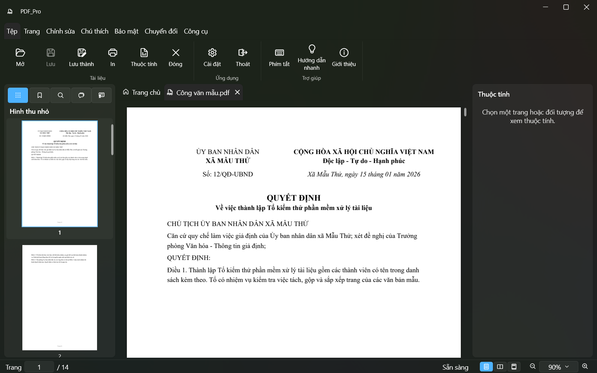
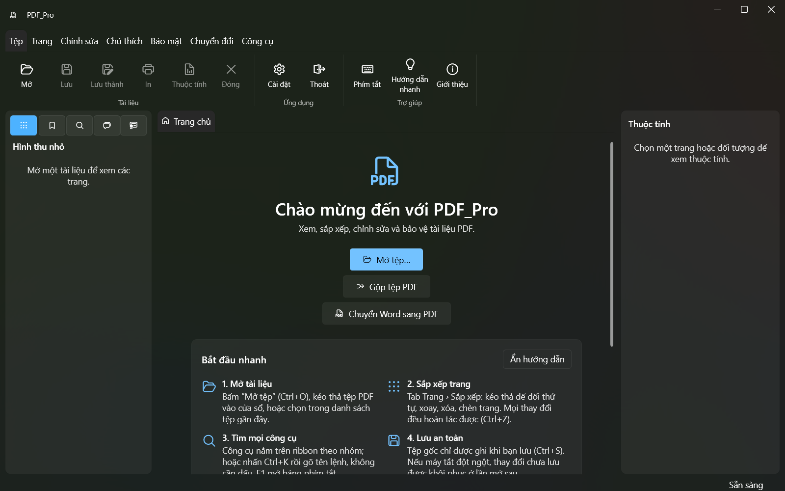
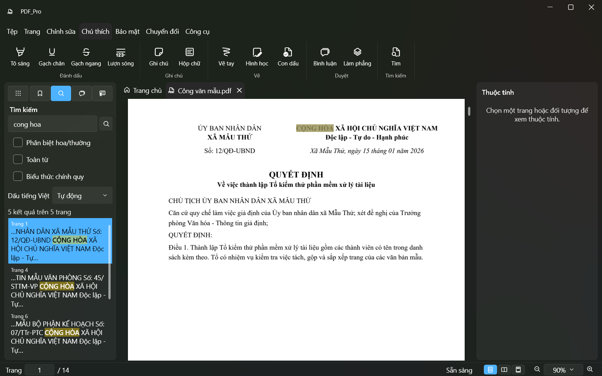
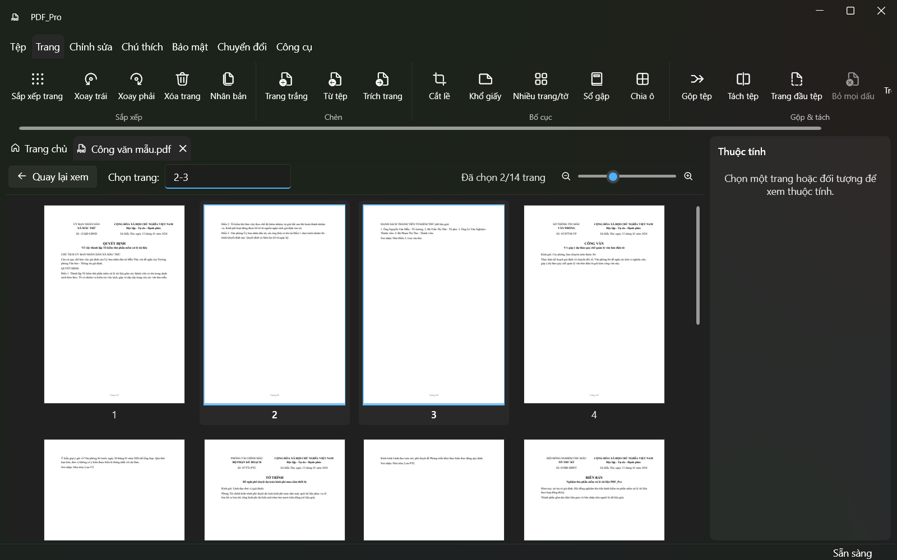
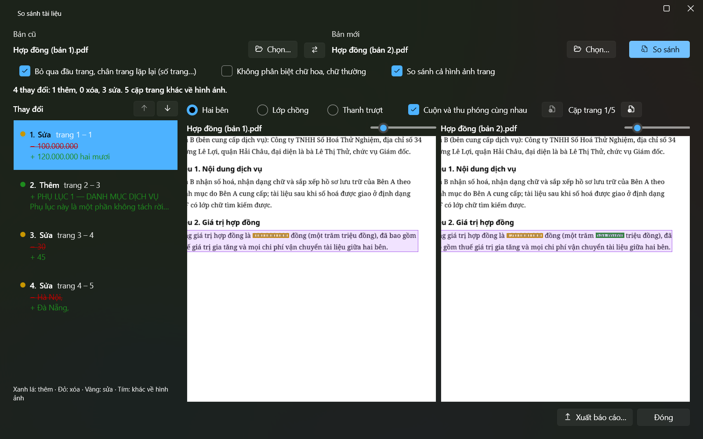
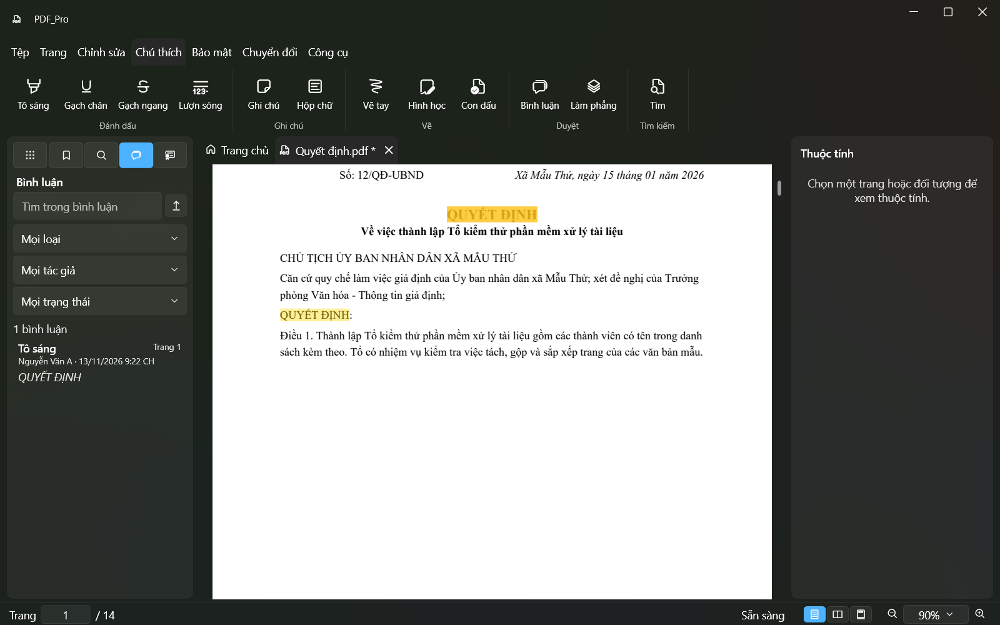
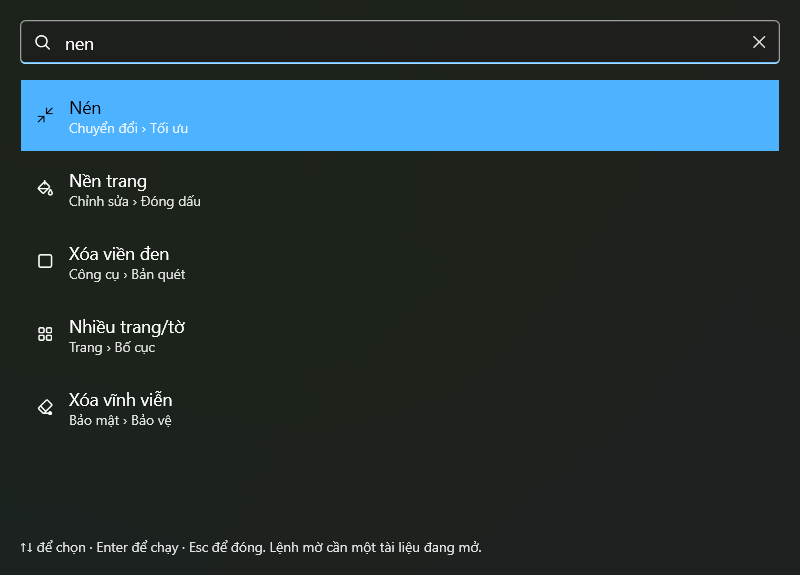

# PDF_Pro

Ứng dụng PDF chuyên nghiệp cho Windows, tiếng Việt là trên hết: xem, sắp xếp, gộp/tách, chèn và đóng dấu, chú thích,
sửa nội dung, biểu mẫu, bảo mật và ký số, nén và chuyển đổi, OCR tiếng Việt, so sánh, workflow và dòng lệnh — chạy hoàn
toàn trên máy, không gửi tài liệu hay dữ liệu sử dụng đi đâu.



| | |
|---|---|
|  |  |
| Màn hình chính, hướng dẫn nhanh | Tìm "cong hoa" thấy "CỘNG HÒA" |
|  |  |
| Sắp xếp trang (chọn "2-3") | So sánh hai bản hợp đồng: chữ và hình ảnh |
|  |  |
| Tô sáng một kết quả tìm kiếm, panel Bình luận | Tìm lệnh bằng Ctrl+K, gõ không dấu |

Ảnh chụp từ ứng dụng thật trên các tệp mẫu (dữ liệu giả) bằng `tests/PdfPro.App.UiTests/ReadmeScreenshots.cs`:
`$env:PDFPRO_SCREENSHOTS=1; dotnet test --project tests\PdfPro.App.UiTests -c Release -- --filter-class "*ReadmeScreenshots"`.

## Tính năng

| Nhóm | Có gì |
|---|---|
| Xem & tổ chức | Trình xem PDFium nhanh, tab, thumbnail, bookmark, in; sắp xếp/xoay/xóa/chèn/trích trang, cắt lề, đổi khổ; gộp, tách, N-up, sổ gập — mọi thao tác hoàn tác được, tệp gốc chỉ ghi khi lưu |
| Chỉnh sửa | Chữ, ảnh, hình, chữ ký tay, hình mờ, đầu/chân trang, số trang, Bates; sửa chữ và ảnh có sẵn; chú thích đầy đủ, bình luận, làm phẳng |
| Biểu mẫu | Điền, thiết kế, nhận diện trường, nhập/xuất JSON/XFDF, trộn từ CSV/Excel |
| Bảo mật | Mật khẩu + quyền AES-256, xóa vĩnh viễn có kiểm lại, làm sạch, ký số và kiểm tra chữ ký |
| Tối ưu & chuyển đổi | Nén, tối ưu web, sửa tệp hỏng, thang xám, PDF/A, sang ảnh/văn bản/Markdown, ảnh sang PDF, Word/Office sang PDF (bằng Microsoft Word hoặc WPS Office có trên máy, hoặc LibreOffice); mở thẳng tệp Word là ra PDF |
| OCR & bản quét | OCR tiếng Việt (Tesseract), xóa trang trắng, xoay đúng chiều, làm thẳng, xóa viền đen |
| Phân tích | So sánh hai tài liệu, trích bảng sang Excel/CSV, trích ảnh, tệp đính kèm, phông chữ |
| Tự động hóa | Tìm lệnh (Ctrl+K), workflow `.pdfflow`, chạy lô, hot folder, CLI `pdfpro` ([docs/CLI.md](docs/CLI.md)) |

## Cài đặt

Tải `PDF_Pro-win-Setup.exe` (hoặc bản ARM64) ở trang **Releases** của kho này và chạy — không cần quyền quản trị, không
cần cài .NET. PDF_Pro tự kiểm tra bản mới khi mở (tắt được trong Cài đặt) và cài khi bạn đóng ứng dụng.

## Build từ mã nguồn

Cần Windows 10/11 và .NET SDK 10 (phiên bản ghim trong `global.json`).

```powershell
git clone <địa chỉ kho>
cd PDF-pro
powershell -ExecutionPolicy Bypass -File tools\fetch-tools.ps1   # qpdf + Tesseract + dữ liệu tiếng Việt (một lần)
dotnet build PdfPro.slnx -c Release
dotnet test --solution PdfPro.slnx -c Release
dotnet run --project src\PdfPro.App -c Release
```

- Kiểm thử giao diện (FlaUI, cần màn hình): `$env:PDFPRO_UI_TESTS=1; dotnet test --project tests\PdfPro.App.UiTests -c Release`.
- Đo hiệu năng: `dotnet run -c Release --project benchmarks\PdfPro.Benchmarks -- budgets`.
- Phát hành: [docs/RELEASE.md](docs/RELEASE.md).

## Cấu trúc

`src/PdfPro.Core` (mô hình, không phụ thuộc WPF/thư viện PDF) ← `PdfPro.Pdfium` ← `PdfPro.Operations`, `PdfPro.Ocr`,
`PdfPro.Infrastructure` ← `PdfPro.App` (WPF), `PdfPro.Cli`, `PdfPro.Worker`. Đặc tả: [docs/SPEC.md](docs/SPEC.md);
tiến độ: [docs/PROGRESS.md](docs/PROGRESS.md); luật cho người đóng góp và AI agent: [AGENTS.md](AGENTS.md).

## Giấy phép

Chỉ dùng thành phần mã nguồn mở có giấy phép cho phép phân phối (không AGPL/GPL, không thư viện thương mại) — danh sách
đầy đủ trong [THIRD_PARTY_NOTICES.md](THIRD_PARTY_NOTICES.md), toàn văn trong [licenses/](licenses/).
